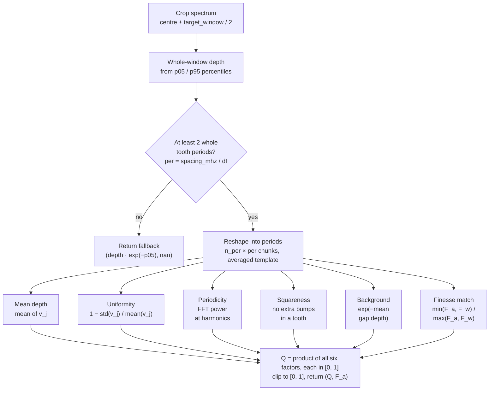

# SHburning

Spectral hole burning in Pr:YSO, and atomic frequency comb (AFC) design.

The simulation is a Python port of the MATLAB "Bloch-Simulator"
(<https://zenodo.org/records/16962167>). It was originally written across the
`SHsimulation_v1*.ipynb` notebooks; the reusable code now lives in a single
module, `shb.py`, with a PyQt6 GUI (`shb_gui.py`) on top.

## Install

```bash
pip install -r requirements.txt
```

### Used elsewhere

[Flyswatter](https://github.com/Tymin0912/flyswatter)'s "Spectral Feature
(SHB)" tab vendors a copy of `shb.py` (not a pip dependency - see that
repo's `third_party/shb/NOTICE.md`) to run the burn / preparation-sequence
machinery (everything except `run_scan`) and hand a burnt spectrum to its
solver. See `shb.py`'s module docstring for the layout and `CLAUDE.md` for
the invariants a caller has to respect (`df`, stage ordering, ...).

## Run

Desktop GUI:

```bash
python shb_gui.py
```

Module smoke test (burns one default comb, prints the OD summary):

```bash
python shb.py
```

Use it as a library:

```python
import shb

params = shb.DEFAULT_PARAMS
params["output_params"]["norm"] = shb.normalisation_factor(params)

out = shb.run_burn(shb.single_hole(0.0), params, pump_passes=10)
print(out["spec"].min(), out["spec"].max())
```

## What it does

`params` is a nested dict:

| section | keys |
| --- | --- |
| `crystal_params` | `g`, `e` level energies (MHz); `dm` `n×n` branching / relative-dipole matrix |
| `linewidth_params` | `h_width` (homogeneous FWHM), `in_width` (inhomogeneous FWHM) |
| `numerical_params` | `fmin`, `fmax` spectrum window; `df` mesh step |
| `burn_params` | `pump_passes` |
| `output_params` | `alpha` (absorption scale), `norm` (unburned peak, computed) |

### Crystal presets

`shb.PRESETS` (GUI: the crystal dropdown) holds ready-made configurations. The
default `Pr:YSO (site 1, tuned)` uses the Nilsson/Sharma branching matrix;
`1.4% Pr:LaWO` (1.4% Pr:La2(WO4)3) uses directly supplied levels and linewidths with a
uniform placeholder `dm`; the four `Pr:CaWO4 (Fig. 6…)` presets (500 ppm
Pr:CaWO4, Yang et al., PRA 107, 022802 (2023)) share measured splittings but
cross the paper's two candidate ground orderings (Fig. 6a/b) with its two
candidate excited orderings (Fig. 6d/e) - `6b+e` is the authors' conclusion;
the others are transcribed from the original MATLAB source
(`zenodo.org/records/16962167`):

| preset | levels | `dm` | h_width / in_width | window |
| --- | --- | --- | --- | --- |
| `Pr:YSO (site 1, tuned)` | 3 g / 3 e | measured 3×3 | 0.001 / 10000 | ±50 |
| `Pr:YSO (MATLAB source)` | 3 g / 3 e | uniform | 0.02 / 2000 | ±200 |
| `1.4% Pr:LaWO` | 3 g / 3 e | uniform | 0.0253 / 18800 | ±100 |
| `Pr:CaWO4 (Fig. 6a+d / 6a+e / 6b+d / 6b+e, paper)` | 3 g / 3 e | uniform | 0.00428 / 85460 | ±200 |
| `151Eu:YSO (site 1)` | 3 g / 3 e | uniform | 0.1 / 2000 | ±1000 |
| `171Yb:YSO (site 2)` | 4 g / 4 e | 4×4 (D2 axis) | 0.5 / 1000 | −2000 … 10000 |
| `Zeeman doublet` | 2 g / 2 e | uniform | 0.1 / 2000 | ±1000 |

Each preset also carries a suggested `fmin/fmax/df`; the GUI writes those into the
fields when you pick it. The core handles any square `n×n` level structure.

Four ways to use it, mirrored by the GUI's **mode** selector:

1. **Single hole** - one pump frequency, burned `pump_passes` times.
2. **One comb** - an AFC set by its **storage time** (us) and **finesse**,
   mapped to the mesh by `comb_for` with the same rule a scan cell uses
   (`comb_steps`), so a scan winner's `(t, F)` re-burns identically. (`comb_at`
   still builds a comb from a tooth spacing and burn width in MHz.)
3. **Scan** - `run_scan(storage_min, storage_max, n_points, finesse_min,
   finesse_max, n_finesse, target_window, top_n, pump_passes, ...)` sweeps AFC
   **storage time** x comb **finesse** (`F = tooth_spacing / tooth_width`) and
   scores each spectrum by its **AFC comb quality** over the central
   `target_window` - `mean_j(v_j) * uniformity * periodicity * squareness *
   background * finesse_match`, where `v_j` is the robust per-tooth-period
   depth (5th/95th percentiles), `uniformity` penalises tooth-to-tooth scatter,
   `periodicity` is the fraction of the windowed AC power at harmonics of the
   comb period, `squareness` penalises ringing / sub-structure inside a tooth,
   `background = exp(-d0)` charges the absorption `d0` left in the gaps (the
   mean below half height - it absorbs input light that is never rephased), and
   `finesse_match = min(F_a, F_w) / max(F_a, F_w)` compares the written finesse
   `F_w` (the scan's finesse axis) with the finesse `F_a` the burned comb
   actually has (from its half-height duty cycle - broadening often spreads a
   comb written at F = 10 to F ~ 2). Each factor is in `[0, 1]`, so a comb has
   to be deep, regular, periodic, square, empty between its teeth *and* as fine
   as written to score well. The spectrum is in `alpha` units, so `background`
   is the physical AFC `exp(-d0)` loss only when `alpha` is set to the
   crystal's real optical depth. **Scores are not comparable across
   `QUALITY_VERSION`s** (currently 3), and resuming an older simulation
   folder is refused. Keeps the best-finesse
   spectrum at each of the top *N* storage times (never two spectra at the same
   storage time), picked best first and kept at least `min_storage_sep` µs
   apart so they are distinct combs rather than one cluster of near-identical
   neighbours - `"auto"` (default) is `(storage_max - storage_min) / (2N)`,
   `0` turns it off, and a wide gap can keep fewer than *N*. Both
   grids are **linear**: `n_points`
   storage times (µs) evenly across `[storage_min, storage_max]` and `n_finesse`
   finesse values evenly across their range, so the heatmap axes are uniformly
   spaced. Each cell keeps its requested `(storage_us, finesse)`, and the burn
   behind it has a mean tooth period of exactly `1 / t` MHz: the period is a
   fractional number of `df` steps and each tooth starts on the nearest mesh bin
   (`shb.period_steps` / `shb.comb`), so the storage times actually burned are
   as evenly spaced as the ones requested - rounding the period itself to the
   mesh would bunch them at short `t` and leave gaps growing as `t² · df` at
   long `t`. `results` are dicts
   `{spacing_MHz, width_MHz, finesse, storage_us, quality, measured_finesse}`:
   `finesse` is the written `F_w` you asked for (the heatmap's axis), and
   `measured_finesse` the `F_a` the burned comb actually came out with - the
   same number `finesse_match` uses, recorded per cell (and per kept spectrum
   in `best`) so you can see how far broadening pulled the comb from what was
   written. It is `nan` where no whole period fits the window, and for cells
   resumed from a folder checkpointed before it was recorded. The price of a
   fractional period is that each tooth sits up to `df/2` off its ideal
   position, so `run_scan` **refines `df`** by a whole factor (so it still divides
   the crystal levels and window edges) until neighbouring storage times differ
   by at least one mesh step of tooth spacing, bounded below by what is physically meaningful (~
   `h_width/5`) and by a spectrum-array-size cap. The refined value is returned
   as `df_used` and both the refinement and any remaining unresolved points are
   logged. A finer mesh means slower burns - the up-front time estimate reflects
   it.
   Runs on a `multiprocessing.Pool` **by default** (`parallel=True`,
   `n_workers=os.cpu_count() - 1`, so the machine stays responsive; GUI: the
   *multiprocessing* checkbox, ticked by default); pass `parallel=False` for a
   single-process sweep. Each point in the sweep returns only its score, not
   its spectrum - the top-N spectra are re-burned in a short collect pass once
   the winners are known, so a long sweep's memory stays flat rather than
   growing with the grid. A pre-flight check estimates the memory a worker
   needs and clamps `n_workers`/`top_n` (or refuses to start, with a specific
   fix to try) rather than letting the sweep swap or get OOM-killed.
4. **Preparation sequence** - an ordered list of burning pulses, for the
   features a single comb cannot make: a GEM peak, a narrowband AFC. See
   *Preparation sequences* below.

### AFC comb quality

The score above is `shb._score_quality_and_finesse(f, spec, target_window,
spacing_mhz, width_mhz)`, which returns `(Q, F_a)`; `_score_quality` is the
score-only wrapper. A window with fewer than two whole tooth periods has no
comb to measure, so it falls back to the whole-window depth and `F_a = nan`.



### Preparation sequences

A comb is one flat set of pump frequencies, all burned at once. A *preparation
sequence* is ordered: each stage burns onto the populations the previous stage
left. That ordering is physics, not bookkeeping - burn a pit and its burn-back
pulses simultaneously and the anti-hole is erased as fast as it is filled.

A sequence is built from **rows**, one per burning pulse:

| field | meaning |
| --- | --- |
| `label` | the stage this row belongs to |
| `centre` | centre frequency (MHz), on the `df` mesh |
| `sweep` | the frequency span the row's pulse is spread over (MHz) |
| `passes` | pump passes for this stage (blank = the configured `pump_passes`) |
| `on` | untick to keep a row without burning it |

`shb.pulse_group(centre, sweep, params)` expands a row: `sweep=0` is a single
pulse at `centre`, otherwise every mesh bin across the span is hit - always at
the crystal's own `df` resolution, so there is no separate "how many pulses"
knob to set. **Consecutive rows sharing a label form one stage**, burned
together - so the teeth of a comb (many rows, one label) go in at once as a
comb burn does, while a pit and its burn-back (different labels) stay
strictly ordered.
`shb.sequence_stages(rows, params)` does the grouping;
`shb.run_sequence(stages, params)` burns them and returns exactly what
`run_burn` returns, plus `stages`.

Two presets (`shb.PREP_PRESETS`, the *Load preset* button in the editor) build
their rows from **the loaded crystal's own level structure** rather than from
written-down numbers, so they follow whichever preset or hand-edited level table
is in use:

- **Gradient echo memory (GEM)** - `shb.prep_gem`. A wide *pit* empties the
  band; *burn back* pulses outside the pit push population into the ground state
  that absorbs at the centre, giving a narrow anti-hole; *clean* sweeps take out
  the rest of the pit and deepen the floor around it.
- **Narrowband AFC** - `shb.prep_narrowband_afc`. Pit and burn-back as above,
  the burn-back *swept across the band* so the whole band absorbs again, then an
  *afc comb* (`shb.comb_in`) burned over a few MHz inside it rather than across
  the whole inhomogeneous line.

Two helpers carry the physics:

- `shb.anti_hole_pumps(centre, params, avoid=(lo, hi))` - the burn-back
  frequencies. Absorption at `centre` comes from the class
  `d0 = centre - trans[k0, m0]` through its population in ground state `k0`,
  which the pit emptied. Pumping any *other* transition `(k, m)` of that class,
  at `trans[k, m] + d0`, drops a share `dm[k0, m]` back into `k0`. Candidates
  inside the pit are dropped (nothing left there to move, and it would re-burn
  the pit) and the rest are ranked by `dm[k0, m0] * dm[k0, m]`.
- `shb.peak_shadow_bands(centre, params, targets, peak_width)` - the bands a
  cleaning sweep must skip. The peak's own ions also absorb at
  `centre + trans[k0, m] - trans[k0, m0]` for every other `m`, and several of
  those sit inside the pit; sweeping over them pumps the peak straight back out.
  `prep_gem` cuts these gaps into its cleaning rows - without them the cleaning
  stage destroys the feature it is meant to sharpen.

### Simulation folders (checkpoint / resume)

Pass `sim_dir=` to `run_scan` (in the GUI: the *simulation folder* field on the
Scan page, auto-named under a root you pick once) and every completed burn is
appended to `sim_dir/progress.csv` as it finishes - flushed and fsynced every
few points or ten seconds, whichever comes first. A crash, a `Cancel`, or a
power loss then loses at most a few seconds of work, not the whole run: opening
the same folder again (`resume=True`, the default) picks up only the unburned
cells. The folder also carries `manifest.json` (the settings a resume is
checked against - `df_used`, the crystal, the window, pump passes, the burn
mode - refused with a diff if they no longer match), `status.json` (a live
"how far in" view, and the run's lock - two processes cannot write the same
folder at once), and, once a sweep finishes, `results.csv`
(`shb.RESULTS_COLUMNS`, the `results` keys above), `best.json` +
`top_spectra.npy` and `figures/*.png` (`shb.SCAN_FIGURES`; plus one image per
kept spectrum in `figures/top_spectra/`). Each `progress.csv` row carries the
burn's score and its measured finesse; a folder written before that column
existed still resumes - its old rows read as `measured_finesse = nan`, new rows
are appended with it, and the kept spectra are measured directly when they are
collected. `shb.load_run(sim_dir)` reads a folder
back - complete, cancelled, or crashed - into the same dict `run_scan` returns;
`shb.inspect_run(sim_dir)` is a cheap summary for a GUI to poll;
`shb.collect_top(sim_dir)` (re-)burns the top spectra from the checkpoint alone,
without resweeping.

A long scan does not need the GUI open: `python shb.py scan --sim-dir ... `
runs headless, `--resume` (the default) continues an interrupted one, and
`python shb.py status --sim-dir ...` / `collect --sim-dir ...` check on or
finish a run from the checkpoint. See `python shb.py scan --help`.

### Teams notifications

A scan that finishes or fails can post to a Microsoft Teams channel via a
Power Automate webhook - useful for exactly the unattended, headless scans
above. Set the webhook URL either as the `SHB_TEAMS_WEBHOOK` environment
variable, or in a `.teams_webhook` file (one line, the URL) next to `shb.py` -
both are checked by `shb.resolve_teams_webhook()`, env var first. Neither is
required; with nothing configured, notifications are a silent no-op.

**The webhook URL is a bearer secret** - anyone holding it can post to your
channel - so `.teams_webhook` is gitignored and must never be committed.

Once configured, every scan (GUI or `python shb.py scan`) posts automatically:
one message when it completes (`state == "complete"`, with the best kept
spectrum's quality/storage-time/finesse if any were kept), one when it
genuinely fails (`state == "failed"`, including the pre-flight
not-enough-memory refusal). A user-initiated `Cancel` never posts - that is a
choice, not a failure. A notification failure (webhook unreachable, etc.) is
logged and otherwise ignored; it never affects the scan itself.
`shb.notify_teams(title, text)` and `shb.scan_teams_notifier()` (an
`on_done` callback for `run_scan`) are the two building blocks, if you want to
wire this into another script.

### The `df` rule

`df` must divide every level energy **and** both window edges exactly, or the
transition table and spectrum axis fall between bins and the result is silently
wrong. `validate_params` and `to_steps` raise `ValueError` when it does not. For
the default crystal (levels given to 0.01 MHz) that means `df` of 0.01, 0.005 or
0.001. Finer `df` costs more, but far less than it used to (see below).

### Speed

`spectrum()` is the per-scan-point hot spot. It now evaluates the homogeneous
Lorentzian sum as one FFT convolution per ground state (`scipy.fft`) instead of a
Python loop over every detuning bin, and `burn_parallel()` places every pump
frequency with a single `np.bincount` instead of a loop. `run_scan` builds the
transition table, axes and FFT kernel once and reuses them for the whole sweep
(and hands them to the worker processes once, not per task), and only computes the
unique `(spacing, width)` burns even when several finesse points map to the same
one. The result matches the original triple-loop (`shb._spectrum_loop`, the
MATLAB reference) to ~1e-13. A high-resolution scan that used to take minutes now
takes seconds.

## GUI layout

The left column has two tabs.

**Simulation** tab:
- *Import config (.json)…* button (see below).
- **Crystal parameters** - the crystal-preset dropdown (see *Crystal presets*
  above; picking one loads its levels, linewidths and a suggested window/mesh),
  a *Relative dipole strength* toggle (off = every transition equally strong),
  and an *Edit levels…* dialog for `g` / `e` / `dm`, which draws the level
  structure (`shb.plot_level_diagram`) live as you edit, with each
  transition weighted by its `dm` entry.
- **Simulation Parameters** - `fmin`/`fmax`/`df`, `h_width`/`in_width`,
  `pump_passes`, burn mode, `alpha`, the mode selector and its fields (Scan:
  storage-time min/max (µs) + **storage-time points**, finesse min/max +
  **finesse points**, target window, keep top N storage times, min storage separation
  (auto or µs), multiprocessing on by default;
  Preparation sequence: an *Edit sequence…* dialog - a table of pulse rows, the
  GEM / narrowband-AFC presets with their parameters, and add / remove / reorder
  buttons, since the row order is the burn order),
  **Run** (becomes **Cancel** while busy) and a progress bar. The bar shows an
  elapsed timer for a single burn, and for a scan an up-front time estimate
  followed by a live `done/total · ~mm:ss left` readout.

**Export** tab - bundle the current run to a folder. Tick any of *Run log*,
*Simulation config (JSON)*, *Figures*, *Data*, set a filename prefix (auto-filled
from the run), then *Export…* picks the folder. Written files, for prefix `P`:

| item | burn | scan |
| --- | --- | --- |
| run log | `P_runlog.txt` | `P_runlog.txt` |
| config | `P_config.json` (`{params, gui}`) | same |
| figures | `P_plot.png` | `P_plot.png` + `P_heatmap.png`, `P_measured_finesse.png`, `P_finesse_written_vs_measured.png`, `P_quality_vs_storage.png`, `P_topspectra.png`, `P_top_spectra/` (one PNG per kept spectrum) |
| data | `P_spectrum.npy` (`vstack[f,spec]`), `P_spectrum.csv` | `P_results.csv` (`spacing_MHz,width_MHz,finesse,storage_us,quality,measured_finesse`), `P_top_spectra.npy` (row 0 = `f`, then each kept spectrum), `P_scan.pkl` |

Right column: one figure with the **pump comb** on top and the **spectrum**
below, sharing the Frequency axis. A preparation sequence draws the top panel as
one band per stage, stacked in burn order and labelled on the y-axis - **left-drag across it to zoom the x-axis**
(as in the notebook's plotly plots), **double-click or the Home button to reset**,
or use the toolbar. A scan replaces both with a single full-height view: the
**AFC comb-quality heatmap** over storage time (`1/tooth_spacing`, µs) x finesse
(`tooth_spacing/tooth_width`), *quality vs storage time* (best / mean / worst over
finesse at each storage time), *top spectra*, a **measured-finesse heatmap**
(the finesse each burned comb actually has, on the same storage x written-finesse
grid as the quality heatmap), or a *measured vs written finesse* scatter
(coloured by quality, with the `F_a = F_w` line for reference) - chosen by the
*Scan view* dropdown. The best-comb legend, the top-spectra labels and the run
log quote the measured finesse next to the written one, e.g. `F 10.0 (measured
2.1)`. The two measured-finesse views show a note instead of a plot for a scan
saved before measured finesse was recorded. In the top-spectra view the legend is a scrollable side panel of
per-trace checkboxes; toggling one hides that spectrum and rescales the y-axis to
what is left. Below is the **Simulation run log**, whose lines are stamped
`[dd:mm:yyyy hh:mm:ss]` and, during a run, carry the elapsed time and a periodic
solver-status line. Both left-hand tabs scroll, so no control is out of reach on
a short window.

**Import config** reads a `P_config.json` back and restores the whole session -
crystal preset, levels, linewidths, numerical fields, mode and its fields, the
dipole toggle. A bare `params` JSON (no `gui` key, e.g. from
`shb.params_to_json`) also loads.

**File** menu: *Import config*, *Export*, *Quit*.

## Figure style

The matplotlib figures use `signature.mplstyle` (Times New Roman, grid, inferno
heatmaps) - the same look as the notebook write-up figures. `shb.apply_style()`
applies it process-wide; the GUI calls it at startup. If the file is missing the
module falls back to a small inline rcParams set.

## Files

| file | purpose |
| --- | --- |
| `shb.py` | the simulator: config, core physics, combs, preparation sequences, scan, plot helpers, `apply_style()` |
| `shb_gui.py` | the PyQt6 GUI |
| `signature.mplstyle` | shared matplotlib style, ported from `SHsimulation_v1_7.ipynb` |
| `worker.py` | thin `from shb import *` shim, kept so `SHsimulation_v1_3test2multi.ipynb` still runs |
| `SHsimulation_v1*.ipynb` | the original working notebooks, left as they are |

All computation in the GUI runs on a background thread, so the window stays
responsive and a scan can be cancelled mid-run.
